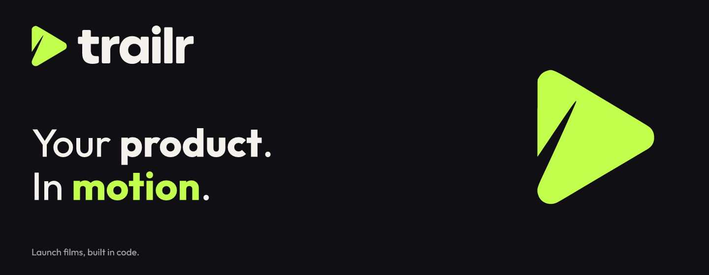
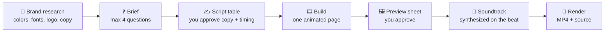

<p align="center">
  
</p>

<p align="center">
  <b>A skill that turns your product into a launch film.</b><br />
  Launching an app? A new coffee? A studio, a shop, a service?<br />
  Trailr makes the film for it, with your colors, your words, music and real footage when it fits.
</p>

<p align="center">
  <a href="#install">Install</a> ·
  <a href="#use-it">Use it</a> ·
  <a href="#how-it-works">How it works</a> ·
  <a href="#what-you-get">What you get</a> ·
  <a href="#narration-and-stock-footage">Narration &amp; stock</a> ·
  <a href="#inside-the-skill">Inside the skill</a>
</p>

<p align="center">
  
  
  
  
</p>

<p align="center">
  
</p>
<p align="center"><sub>Made with Trailr from its own template. Three fictional brands, one skill. Coffee footage from Pexels by <a href="https://www.pexels.com/video/close-up-view-of-coffee-beans-falling-in-slow-motion-16246463/">Joshua Woroniecki</a> and <a href="https://www.pexels.com/video/close-up-of-coffee-being-poured-into-cup-6950167/">Sascha Weber</a>.</sub></p>

---

Most AI-made launch videos look like slide decks: title, fade, screenshot, fade, logo. Trailr makes **films**: one animated page where every frame is a function of time, a camera that travels between scenes, headlines that build word by word, real-looking product UI, and a soundtrack whose cuts land on the beat.

- 🎬 **Your brand, not a template.** It reads your site for the real colors, fonts, logo, copy and product UI. A SaaS, a studio and a coffee roaster each get a film that looks like them.
- 🎥 **Real footage when it fits.** Coffee being poured, a busy street, hands at work, mixed with your animated screens and words.
- ✍️ **You own the script.** Every on-screen line and every scene length is approved by you before anything renders.
- ⏱️ **Retime in seconds.** Make one scene longer and everything after it (animation, music, sound effects) moves with it.
- 📱 **Horizontal, vertical or square**, with layouts made for each, not crops.
- 🎵 **Music and sound effects synthesized for the film**, on the same beat grid as the cuts. Narration optional.
- 📦 **Editable source delivered with the MP4**, so you can change a word and re-render.

## Install

> **We recommend [Claude Code](https://code.claude.com) with a recent Claude model.** It's what we build and test Trailr with. Other agents that read the same skill format also work.

**Claude Code**, as a plugin (easy to update):

```text
/plugin marketplace add fecab0/trailr
/plugin install trailr@trailr
```

**Any agent** (Claude Code, Codex, Cursor, Gemini CLI, opencode and more) with the [`skills`](https://github.com/vercel-labs/skills) installer:

```bash
npx skills add https://github.com/fecab0/trailr --skill trailr
```

Add `-g` to make it available in every project. Then start a new session and type `/trailr`.

<details>
<summary>No installer? Copy the folder by hand.</summary>

Copy the **entire** `skills/trailr/` folder (with `references/`, `scripts/` and `templates/`) into your agent's skills directory. For Claude Code:

| Platform | Destination |
| --- | --- |
| Windows | `%USERPROFILE%\.claude\skills\trailr\` |
| macOS / Linux | `~/.claude/skills/trailr/` |

The entrypoint must end up at `.claude/skills/trailr/SKILL.md` (not `trailr/trailr/SKILL.md`). For a single project, use `<your-project>/.claude/skills/trailr/` instead ([skill locations](https://code.claude.com/docs/en/skills#choose-where-skills-load)). Other agents: point them at `skills/trailr/SKILL.md` following their own instructions.
</details>

**Requirements:** Node.js 18+, Playwright with Chromium, FFmpeg, Python 3 with NumPy and SciPy. Check them with (`<skill>` is the installed `trailr` folder):

```bash
node <skill>/scripts/doctor.js
```

It installs nothing; the agent asks before installing anything either.

## Use it

```text
/trailr Make a 30-second vertical launch video for my product.
Website: https://example.com
Audience: independent designers.
Tone: energetic. Use English copy.
```

Ask for slow, normal or fast pacing, a specific length, both formats, or narration. Everything else Trailr asks you in one short round of questions.

## How it works



The two approvals are where you steer: the **script table** (every on-screen line, each scene's start and length in seconds, the music mood) and the **preview sheet** (stills of every scene and every cut) before the final render.

## What you get

A `trailr-output/` folder in your project:

| File | What |
|---|---|
| `film.mp4` | the finished film, with music and sound effects |
| `script.json` | the approved script: copy, scene lengths, music mood |
| `index.html` | the animation itself; open it in a browser |
| `soundtrack.wav` | the synthesized music and sound effects |
| source zip | everything needed to edit a word and re-render |

For vertical films you also get a cover image for the post thumbnail.

## Narration and stock footage

<details>
<summary><b>Spoken narration</b></summary>

Ask for it explicitly, for example: `/trailr Make a 30-second product demo with English narration and a calm British voice.` The spoken copy joins the script table for approval, takes are measured before the render, and the music ducks under the voice.

For ElevenLabs, connect the official MCP server at `https://api.elevenlabs.io/v1/mcp` in your client and sign in with OAuth; no API key or custom script is needed, and generation uses your workspace credits. Your own recording or a local speech engine also work (not bundled). With Kokoro, Trailr picks a voice explicitly, avoids Michael unless you approve it, and tells you which voice it used.

Details: [Spoken narration](skills/trailr/references/voiceover.md).
</details>

<details>
<summary><b>Stock footage</b></summary>

Trailr can combine licensed stock video (Pexels, Pixabay, Mixkit) with animated UI, type and narration, keeping a license record for every clip. Access can depend on credentials, login and the environment.

Details: [Stock video](skills/trailr/references/stock-video.md).
</details>

## Inside the skill

<details>
<summary>Folder structure</summary>

```text
skills/trailr/
├── SKILL.md                    index: options, which file to read when, steps with gates, rules
├── references/
│   ├── brand-research.md       step 1
│   ├── brief-and-script.md     steps 2–3
│   ├── pacing.md               pace, scene lengths, read times
│   ├── engine.md               step 4
│   ├── sound.md                step 5
│   ├── render-and-deliver.md   steps 6–7
│   ├── creative-archetypes.md  reference films for creative direction
│   ├── vertical-video.md       only when the brief needs them ↓
│   ├── voiceover.md
│   ├── stock-video.md
│   ├── corporate-video.md
│   └── external-tools.md
├── scripts/
│   ├── doctor.js               checks the environment
│   ├── build-script.js         script.json -> script.js + the script table
│   ├── stills.js               preview stills -> contact sheet
│   ├── export.js               page -> timeline.json + sfx.json
│   ├── synth.py                music + SFX + narration -> soundtrack.wav
│   ├── render.js               page -> MP4 with parallel workers
│   └── lib/
└── templates/
    ├── index.html              composition skeleton with a 3-scene demo
    ├── script.example.json
    └── treatment.md
```

`SKILL.md` is a short index: the agent reads it first, then only the reference for the step it is on.
</details>

<details>
<summary>Try the pipeline by hand</summary>

From an empty folder, with the template's demo (`<skill>` is the installed `skills/trailr` folder):

```bash
cp <skill>/templates/index.html .
cp <skill>/templates/script.example.json script.json
node <skill>/scripts/build-script.js script.json
node <skill>/scripts/stills.js index.html
node <skill>/scripts/export.js index.html
python <skill>/scripts/synth.py timeline.json --sfx sfx.json --out soundtrack.wav
node <skill>/scripts/render.js index.html --out film.mp4 --audio soundtrack.wav --fps 30 --draft
```
</details>

## Made with Trailr?

Share your film with **#MadeWithTrailr**, or [open an issue](https://github.com/fecab0/trailr/issues/new) with the link: we'd love to see it, and the best ones may end up in this README.

Add the badge to your project:

[](https://github.com/fecab0/trailr)

```markdown
[](https://github.com/fecab0/trailr)
```

## Made by

**[Vitto](https://github.com/justvitto)** 🇮🇹 and **[Javi](https://github.com/fecab0)** 🇪🇸, somewhere between an espresso and a café con leche.

Want a film made for you, a custom skill for your team, or to build Trailr with us?<br />
👉 Write to us on LinkedIn: [Vittorio Sileo](https://www.linkedin.com/in/vittoriosileo/) · [Javier Fernández Cabrera](https://www.linkedin.com/in/javier-fernandez-cabrera/)

Contributions are welcome: [open an issue](https://github.com/fecab0/trailr/issues) with an idea or a bug, or send a pull request.
